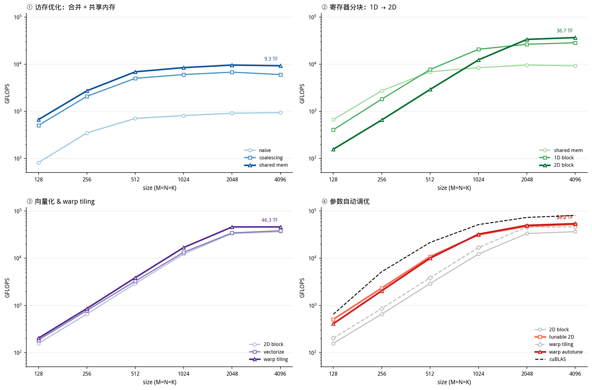
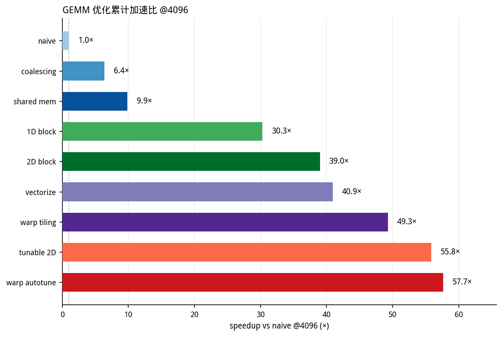
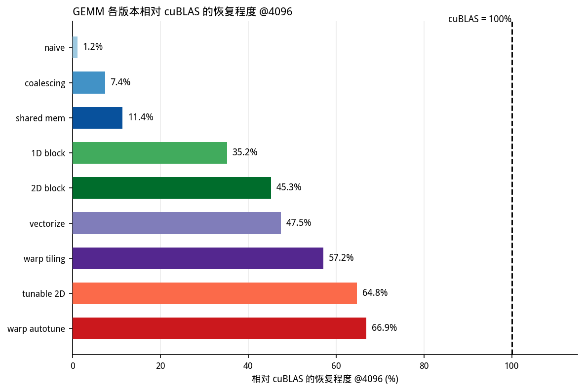

# GEMM 优化逐步 Ablation 报告

从 `naive` 到当前最优 `autotune_more`（warp tiling autotune）的逐级优化过程与实测数据。

> 环境：sm_120（Blackwell）/ nvcc 13.3 / `-O3` / `-std=c++20` / fp32
> 输入：`α=0.5, β=3.0`，随机矩阵；固定内核 50 次重复，autotune 20 次重复
> 尺寸：`M=N=K ∈ {128, 256, 512, 1024, 2048, 4096}`

## 总览

按优化原理分成四组对比（访存 / 寄存器分块 / 向量化&warp / 自动调优）：



各版本相对 naive 的累计加速比（@4096）：



各版本相对 cuBLAS 的恢复程度（@4096）：



## 参考基线 cuBLAS（带 warmup）

| size | 128 | 256 | 512 | 1024 | 2048 | 4096 |
|---|---|---|---|---|---|---|
| cuBLAS | 650 | 5186 | 21698 | 51874 | 73608 | 81043 |

## 完整数据（GFLOPS）

| 版本 | 128 | 256 | 512 | 1024 | 2048 | 4096 |
|---|---|---|---|---|---|---|
| 1 naive | 82 | 348 | 708 | 813 | 912 | 941 |
| 2 coalescing | 503 | 2077 | 5017 | 6026 | 6774 | 6027 |
| 3 shared mem | 668 | 2729 | 6890 | 8459 | 9579 | 9266 |
| 4 1D block tiling | 406 | 1812 | 7701 | 20702 | 26454 | 28506 |
| 5 2D block tiling | 157 | 655 | 2912 | 12345 | 33557 | 36675 |
| 6 vectorize | 185 | 780 | 3276 | 13444 | 34525 | 38497 |
| 8 warp tiling（固定） | 203 | 862 | 3878 | 16915 | 46224 | 46336 |
| **7 tunable 2D（autotune）** | 508 | 2339 | 10878 | 31500 | 48036 | **52509** |
| **9 warp autotune（autotune_more）** | 410 | 2048 | 10057 | 32520 | 49949 | **54228** |

相对 naive 的加速比（@4096）：

`naive 1.0× → coalescing 6.4× → shared mem 9.9× → 1D 30.3× → 2D 39.0× → vectorize 40.9× → warp 49.3× → tunable 2D 55.8× → warp autotune 57.7×`

最终达到 cuBLAS 的 **66.9%**。

## 每一步做了什么、为什么、带来什么

### Step 1 → 2：`naive` → `global_mem_coalescing`（6.4×）

交换线程到元素的映射：naive 里 `x=threadIdx.x`（行）、`y=threadIdx.y`（列），导致相邻线程读 `A[x*K+i]` 跨行 stride=K（未合并）、写 `C[x*N+y]` 也跨行。coalescing 改成 `cRow=threadIdx.y`、`cCol=threadIdx.x`。

效果：同一 warp 相邻线程读 `B[i*N+cCol]`、写 `C[cRow*N+cCol]` 都是连续地址，一次访存事务覆盖整段；`A[cRow*K+i]` 变成 warp 内广播。这是最便宜、收益最大的一步。

### Step 2 → 3：`shared_mem`（1.5×）

把 `BM×BK` 的 A 块和 `BK×BN` 的 B 块搬进共享内存，`__syncthreads()` 后从 SMEM 做点积，显式控制数据复用（不再依赖 L1 命中运气）。但**每线程仍只算 1 个 C 元素**，算术强度低，所以只提升 1.5×。

### Step 3 → 4：`1D_block_tiling`（3.1×）

每线程算 `TM=8` 个元素（C 的一行片段），把 `B_bk` 的一个元素缓存在寄存器 `tmpB` 里复用。register tiling 第一次出现，B 的复用从「读 8 次 SMEM」降到「读 1 次 + 8 次 FMA」。

### Step 4 → 5：`2D_block_tiling`（1.3×）

每线程算 `TM×TN=8×8` 二维 tile，同时缓存 `regM[TM]`、`regN[TN]` 做外积，A、B 两边都进寄存器复用。

### Step 5 → 6：`vectorize`（1.05×）

global→SMEM 的 A/B 读、以及 C 回写都改用 `float4`（128-bit），降低指令条数与访存事务数。受制于 SMEM 带宽与尚未解决的 bank conflict，只小幅提升。

### Step 6 → 7：`warp_tiling`（1.2×）

在 block-tile 内部再分 `WM×WN` 的 warp-tile，按 `LaneSizeN` 分配 lane；**关键是把 `A_bk` 转置成 `[BK][BM]`**。转置把内层循环对 A 的「列读（stride BK=16 → 8-way bank conflict）」变成「行读（stride 1）」，bank conflict 从 8-way 降到 2-way。

## 最重要的洞察：参数 autotune 比「再加一个优化」更值钱

固定的「最优」参数并不优：

| 对比 | 固定参数 | GFLOPS@4096 |
|---|---|---|
| 2D block tiling（手调） | BM=128, BN=128, BK=8, TM=8, TN=8 | 36675 |
| 2D block tiling（autotune 最优） | **BM=64, BN=64, BK=32, TM=8, TN=4** | **52509**（+43%） |
| warp tiling（手调） | BK=16, WM=64, WN=32, LaneSizeN=4, TM=8, TN=8 | 46336 |
| warp tiling（autotune 最优） | **BK=32, WM=32, WN=64, LaneSizeN=8, TM=4, TN=4** | **54228**（+17%） |

三点结论：

1. **仅仅搜 2D block tiling 的参数，就已经反超手调的 warp tiling**（52.5 vs 46.3）。说明手调的 `BK=8` 太小（`__syncthreads` 与 global-load 轮次过多），最优是 `BK=32`；矩形 tile `TM=8, TN=4` 也比正方形 `8×8` 更好地平衡了寄存器压力与访存。
2. 搜 warp tiling 后（`autotune_more`），最优配置 `BK=32, LaneSizeN=8, WM=32×WN=64, TM=4×TN=4` 与手调的 `BK=16, LaneSizeN=4, 64×32, 8×8` 几乎处处不同，最终 54.2 TFLOPS。
3. **`LaneSizeN=8` 是自动搜出来的关键**：把 warp 内 32 个 lane 排成 `(32/8)×8 = 4×8`，配合 `TM=4` 得到 `warpSubTileM=16`，恰好使 `WM=32` 为它的 2 倍（`wmIterMax=2`），进一步摊销了 A 的 bank conflict。

## 最优配置一览（autotune_more 每尺寸）

| size | 最优 warp 配置 | GFLOPS |
|---|---|---|
| 128 | BM=64 BN=64 BK=32 WM=32 WN=32 Lane=8 TM=8 TN=4 | 410 |
| 256 | 同上 | 2048 |
| 512 | BM=64 BN=64 BK=32 WM=32 WN=32 Lane=8 TM=4 TN=4 | 10057 |
| 1024 | 同上 | 32520 |
| 2048 | BM=128 BN=128 BK=32 WM=32 WN=64 Lane=8 TM=8 TN=4 | 49949 |
| 4096 | BM=128 BN=128 BK=32 WM=32 WN=64 Lane=8 TM=4 TN=4 | **54228** |

规律：小尺寸偏好 `BM/BN=64`（更高 occupancy、更多 block），大尺寸偏好 `BM/BN=128`（更多复用）。

## 小尺寸的例外

在 size=128 时，`shared_mem`（668）反而比所有后续复杂内核（warp 203、2D 157）都快：复杂 tiling 的启动开销 + 低 occupancy 在极小规模下得不偿失；甚至 autotune 的最优 2D（508）也没超过 fixed `shared_mem`。**「最优内核」是尺寸相关的**——这正是 autotuner 存在的意义。

## 复现命令

```bash
# 固定内核（0-8）
make all          # 或: nvcc -arch=sm_120 -std=c++20 -O3 -I src -o gemm scripts/gemm.cu src/runner.cu -lcublas
for k in 0 1 2 3 4 5 6 8; do ./gemm $k; done

# autotune（2D block tiling / warp tiling）
python scripts/autotune/GEMM/search.py --kernel tunable
python scripts/autotune/GEMM/search.py --kernel warp

# 结果分析与绘图
python scripts/autotune/GEMM/analyze.py --top 5
python scripts/autotune/GEMM/ablation_plot.py   # 生成本文档的 ablation.png
```
